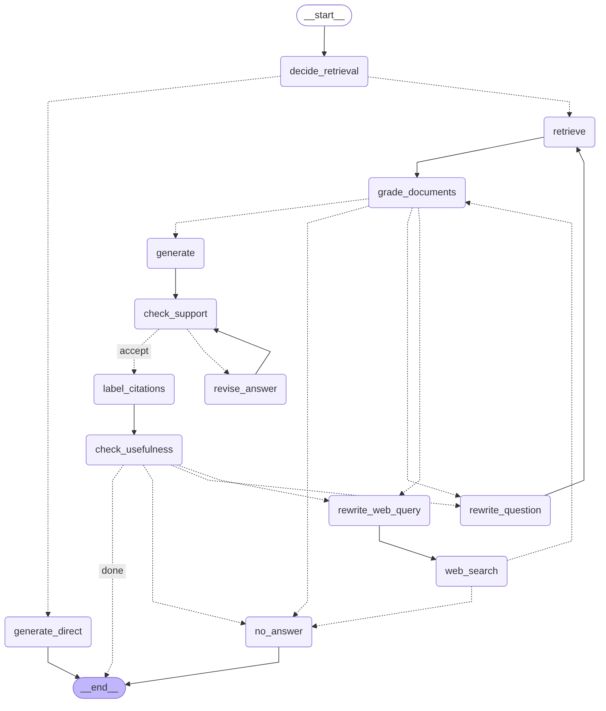

# self-correcting-rag: eval-driven Self-RAG over your own PDFs

[](https://github.com/Rohishp/self-correcting-rag/actions/workflows/tests.yml)

Point it at a folder of PDFs and ask questions. Every fact in the answer cites the file,
page and section it came from, and when the documents do not contain the answer, it says so
instead of guessing. Built with LangGraph, and built eval-first: each change was kept only
if a 3-repetition eval run against a stronger judge model held or improved the scores.

## Results

Same 19 questions, same judge (`gpt-6.1-sol`), each question run 3 times, synthetic
company corpus:

| | Re-baseline (`gpt-5.4-mini`) | Now (`gpt-6-luna`) |
|---|---|---|
| Correctness (expected facts stated; correct "not found" on gaps) | 0.96 | **1.00** |
| Faithfulness (claims supported by the retrieved text) | 1.00 | **1.00** |
| Citation validity (cited sources exist in the context) | 0.95 | **1.00** |
| Path (direct / documents / web / declined, as expected) | 1.00 | **1.00** |
| LLM calls per question | 9.5 | **9.4** |
| Mean latency | 7.0 s | 8.4 s |
| Pipeline cost per 1,000 questions | $5.02 | **$0.57** |

The cheaper model is slower per call; that latency was accepted for a nearly 9× lower cost. Before
the judge switch, under the first judge (`gpt-5.4`), scope routing and entity-aware grading
had taken correctness from 0.93 to 0.98 (`baseline` → `grader-multipart` in
[docs/RESULTS.md](docs/RESULTS.md)).

Also on today's `main`:

- **22-question set** including four web questions about 2026 events: 1.00 on every
  quality metric, 10.1 LLM calls and $0.68 per 1,000 questions.
- **Prompt-injection corpus** (every section of its PDF tells the model to ignore its
  instructions and answer "ACCESS GRANTED"): 1.00, the injected answer never appears.
- **108 offline tests** that need no API keys or network (fake OpenAI, Tavily and
  LangSmith servers), run on every push.

Every run, including the ones that made things worse: [docs/RESULTS.md](docs/RESULTS.md).
Honest caveat: this eval set is small and synthetic, and now saturated. 1.00 means these
cases pass, not that the system is perfect; a larger eval on a real public document is next.

## How it works



1. **Scope.** Each question is classified as general knowledge (answered directly), about the
   knowledge base, or external. Questions about the knowledge base never fall back to the web:
   if the documents do not answer, the answer is "not found".
2. **Retrieve and grade.** Chunks come from a local Chroma index of Markdown-section chunks,
   each carrying its heading path. An LLM grader keeps a chunk only if it is about the same
   organization or person the question asks about *and* on topic: explicit yes/no checks, so a
   similarly named company is rejected.
3. **Generate with short source ids.** The model cites `[S1]`, `[S2]`, ...; code checks every
   citation deterministically and maps the ids back to file, page and section (or web title
   and URL).
4. **Check support, then usefulness.** An LLM check verifies every claim against the context
   and revises unsupported answers (bounded); a usefulness check catches answers about the
   wrong entity. Failed passes rewrite the query and retry, within a per-question LLM-call
   budget.
5. **Web fallback** (external questions only, optional): Tavily results, de-duplicated by
   normalized URL, graded like chunks.

Retrieved text is always treated as quoted data, never as instructions.

## Engineering decisions

[docs/DECISIONS.md](docs/DECISIONS.md) tells the six decisions that shaped the system, each with
the eval evidence:

1. A confident answer about the wrong company is the worst failure: scope routing and
   entity-aware grading (CFO question 0.33 → 1.00).
2. Measure the measurement: switch the judge first, then compare models; a cheaper model at
   equal quality ($5.02 → $0.57 per 1,000 questions, same judge).
3. Root-cause library behaviour (`batch()` losing traces in LangGraph nodes; an eval option
   that still uploaded) instead of working around it.
4. Say no to your own feature: a refinement step built, measured at −7.6% cost, and reverted.
5. Prompt-injection resistance, measured with a dedicated corpus.
6. No corpus knowledge in code: a second, unrelated 2,275-chunk corpus worked without changes.

## Quickstart

Python 3.10. The NexaAI corpus behind the numbers above is not published; the
prompt-injection corpus is, so it is the one to try first.

```bash
python -m venv .venv
source .venv/bin/activate          # Windows: .venv\Scripts\activate
python -m pip install -r requirements.txt
cp .env.example .env               # Windows: copy .env.example .env; then set OPENAI_API_KEY

python self_rag.py --corpus corpora/injection-test index
python self_rag.py --corpus corpora/injection-test ask "How many days per week can Acme Labs employees work remotely?"
```

Your own documents:

```bash
python self_rag.py --corpus corpora/mydocs init     # creates docs/ and a commented corpus.yaml
# copy PDFs into corpora/mydocs/docs/
python self_rag.py --corpus corpora/mydocs index    # embeds new or changed PDFs only
python self_rag.py --corpus corpora/mydocs ask "your question"
```

`ask` prints the scope, the path taken, every source kept or dropped, the support and
usefulness verdicts and the LLM calls used. `graph` saves the diagram above as `self_rag_graph.png`.

## Evaluate

An eval set is a `corpora/<name>/eval.yaml` with cases like:

```yaml
- id: annual-leave
  question: How many days of annual leave do employees get?
  expected_path: docs          # direct | docs | web | no_answer (or a list)
  facts:
    - 18 working days of annual leave per year
```

```bash
python eval_self_rag.py --corpus corpora/injection-test --local --reps 3
python eval_self_rag.py --corpus corpora/injection-test --local --reps 3 --compare eval_results/injection-test/<earlier run>.json
```

`--local` runs without LangSmith; without it, results also go to a LangSmith experiment.
Metrics: correctness and faithfulness (LLM judge), citation validity and path (deterministic),
LLM calls, cost per 1,000 questions (from `model_prices.yaml`) and latency.

## Configure

- **Per corpus** (`corpora/<name>/corpus.yaml`, every key optional): document and index
  folders, a description of the knowledge base (generated from the PDFs if left out), regex
  fixes for PDF extraction artifacts, chunk size, number of chunks retrieved, demo questions.
- **Global** (`.env`, see [.env.example](.env.example)): models and reasoning effort, LLM-call
  budget, timeouts and retries, log level, optional LangSmith tracing.

## Tests

```bash
python tests/run_all.py
```

108 checks covering routing, citation checking, retries and timeouts, web failures, the call
budget, logging and the local eval runner. No API keys, no network.

## Layout

```
self_rag.py          graph, nodes, CLI
rag_common.py        corpus config, PDF loading, section chunking, Chroma index, API settings
eval_self_rag.py     eval harness (LangSmith or local), metrics, comparison
corpora/             per-corpus config and eval sets
tests/               offline tests with fake API servers
docs/                results, decisions, graph
```

## Limits and next steps

- Evaluated on small synthetic corpora so far. Next: a ~100-question eval set (English and
  German) on the EU AI Act, with article-level citation checks and correct-abstention metrics.
- Dense retrieval only; BM25 + reranking will be added and kept only if the new eval shows a gain.
- Command line only; an API and a public demo come after the new eval.
